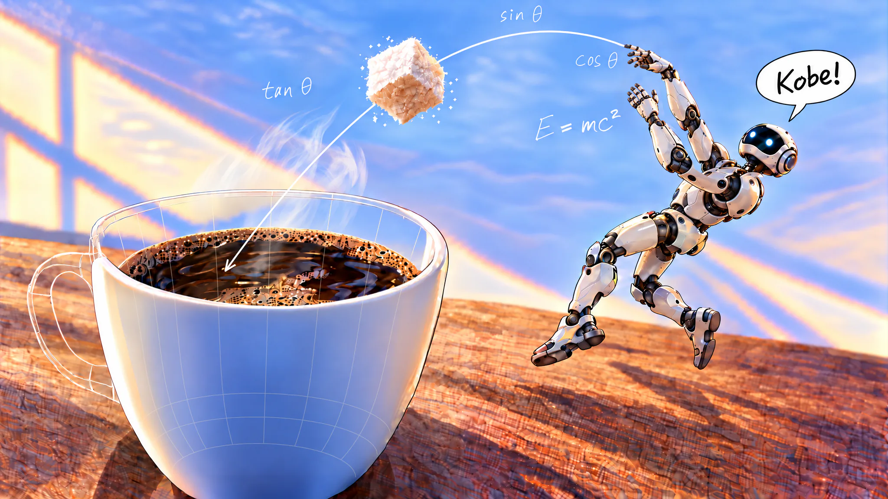

# Intro to World Models and Robot Grandmas

**[Read the post](https://seantey.github.io/world-models-robot-grandmas-blog/intro-to-world-models-n-robot-grandmas-blog.html)**

An introduction to world models, Gaussian splats and collider meshes, and a walkthrough of using World Labs'
Marble to build a robotics simulation, with interactive 3D demos along the way.

- **The demos' code:** readable versions you can run on your own computer are in
  [world-models-robot-grandmas-demos](https://github.com/seantey/world-models-robot-grandmas-demos).
- **Credits and licences** for the assets and tools are at the end of the post.
